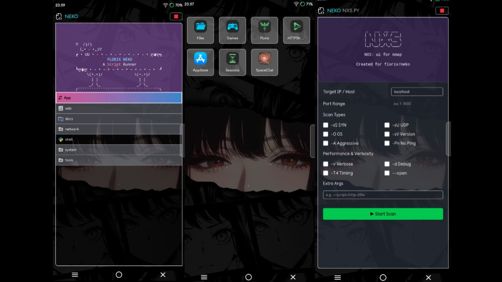
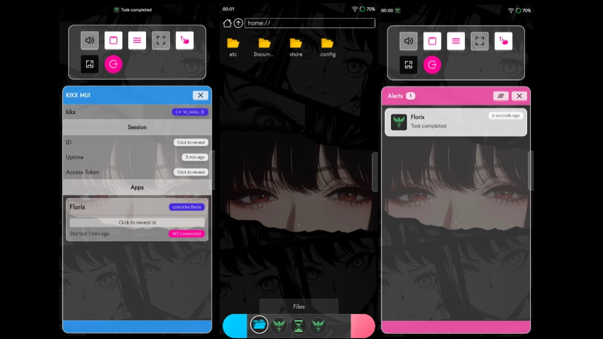

# KIKX-Project

⚠️ Note: KIKX is currently under active development. Features may change, break, or be incomplete as the project evolves.


## 🚀 Overview

**Kikx** is as an application runtime environment where apps (built using HTML, CSS, and JavaScript) run inside isolated iframes, while the Kikx UI connects as a client to manage and launch them.

## 🌟 Screenshots

### MUI (default)




---

## ⚙️ Installation & Setup

Make sure Python 3.12+ is installed and make.

```bash

# close repo
git clone https://github.com/luvbyte/kikx.git

cd kikx

# Setup (creates venv & fs)
make setup

# Start
make run

```

---

## 🐳 Docker

Set a non-empty access key before starting the container:

```bash
export KIKX_ACCESS_KEY='replace-with-a-long-random-value'
docker compose up --build
```

The first start initializes the persistent `kikx-data` volume. Later starts
reuse its configuration, so changing `KIKX_ACCESS_KEY` does not change the
access key in an already-initialized volume. The service is available on
<http://localhost:1303>. The service runs as root inside
the container so apps granted `sudo` can use their expected privileges; those
privileges are container-scoped, but the app can access mounted data.

## ✨ Features

- 🖥️ Virtual OS-like interface in the browser
- ⚡ FastAPI backend for high-performance Python scripting
- ✨ Frontend (MUI) built using Vue, TailwindCSS and DaisyUI

---

## 🚀 Technologies Used

- **Backend:** Python 3, FastAPI
- **Frontend:** Vue, TailwindCSS, DaisyUI

---

## 🔗 Related Projects

- [KIKX-DOCS](https://github.com/luvbyte/kikx-docs)
- [KIKX-APP-SDK](https://github.com/luvbyte/kikx-sdk)
- [KIKX-MUI](https://github.com/luvbyte/kikx-mui)

## License

This project is licensed under the Apache License 2.0 - see the LICENSE file for details.
